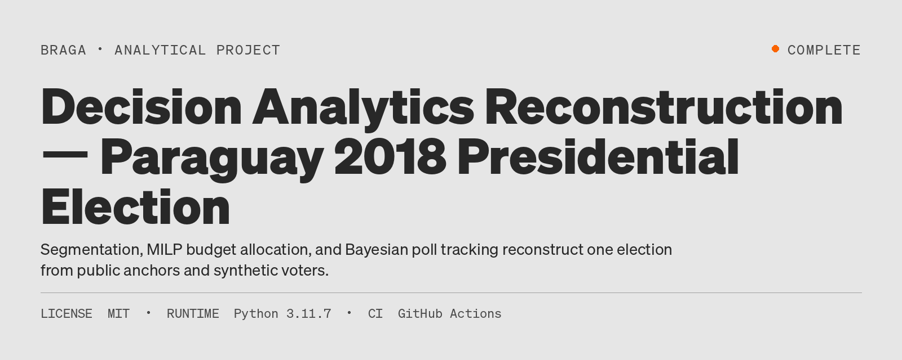
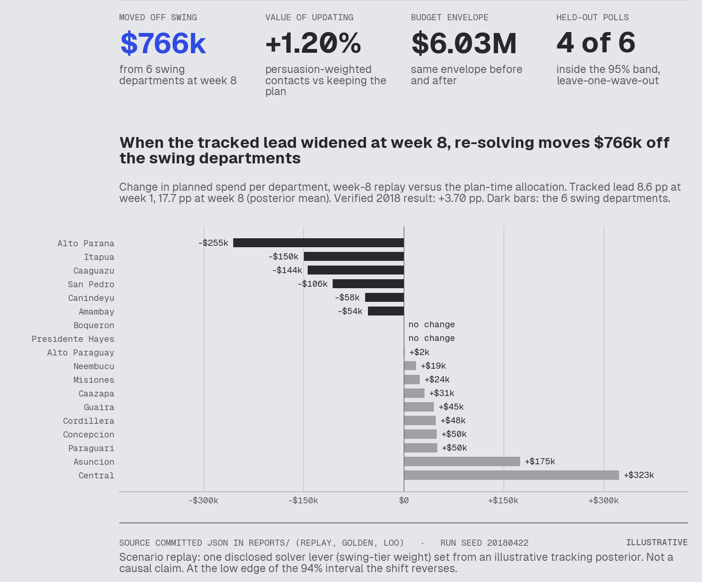
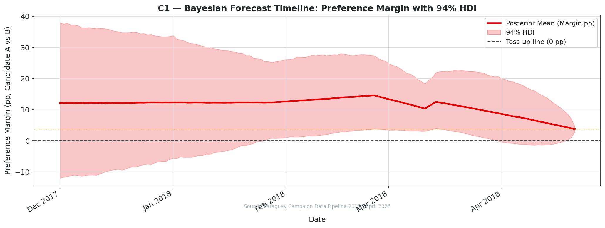
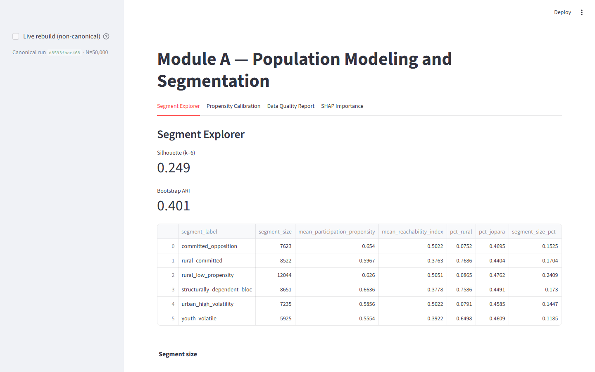
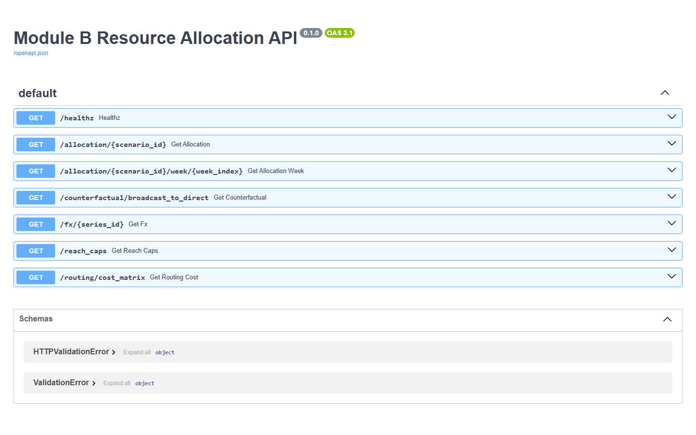
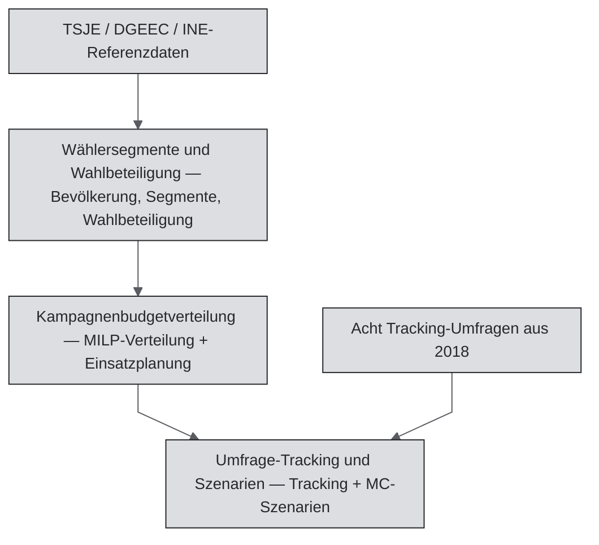

[🇧🇷 PT-BR](README.pt-BR.md) · [🇬🇧 EN-UK](README.md) · [🇦🇹 DE-AT](README.de-AT.md)

# Decision-Analytics-Rekonstruktion — Präsidentschaftswahl Paraguay 2018



[](https://github.com/RafaelBraga-Kribitz/decision-analytics-reconstruction/actions/workflows/ci.yml)
[](https://github.com/RafaelBraga-Kribitz/decision-analytics-reconstruction/actions/workflows/governance.yml)
[](.python-version)
[](LICENSE)
[](#status)

**Status:** Abgeschlossen

> - **Wer entscheidet:** die Kampagnenleitung gemeinsam mit einer Analystin oder einem Analysten.
> - **Was entschieden wird:** wie ein festes Budget auf 18 Departamentos verteilt wird und ob der Plan bei einer Veränderung des beobachteten Vorsprungs neu berechnet werden soll.
> - **Ergebnis:** In Woche 8 wurde der beobachtete Vorsprung größer. Eine Wiederholung, bei der der Plan nach einer manuellen Gewichtsänderung neu berechnet wird, verschiebt **766.000 US-Dollar** aus sechs umkämpften Departamentos. Gegenüber dem alten Plan bedeutet das **+1,20 %** mehr nach Überzeugungskraft gewichtete Kontakte bei einem Budget von **6,03 Mio. US-Dollar**.
> - **Wichtigster Vorbehalt:** Dies ist eine illustrative Wiederholung mit synthetischen Wählern, keine kausale Aussage. Am unteren Rand des 94-%-Intervalls kehrt sich die Verschiebung um.
> - **Diagramm:** das Entscheidungs-Dashboard unten. Details: [Fallstudie, Wiederholung für Woche 8](reports/CASE_STUDY.md#a-worked-decision-week-8-replay).

Zu Beginn des Jahres 2018 standen einer Kampagne nur acht öffentliche Umfragen, Zensusaggregate und ein festes Budget zur Verfügung. **Wie sollte sie den Wahlkampf beobachten, das Geld landesweit verteilen und offenlegen, was bekannt ist?** Dieses Projekt rekonstruiert die paraguayische Präsidentschaftswahl 2018 mit drei miteinander verbundenen Bausteinen der Entscheidungsanalyse. Es beantwortet diese Frage durchgängig. Verifiziertes Ergebnis: Kandidat A (Abdo) gewann mit **+3,70 Prozentpunkten** (46,43 % gegenüber 42,73 %) bei einer Wahlbeteiligung von **61,25 %** (TSJE, die Wahlbehörde). Ein Prozentpunkt ist ein pp.

<p align="center"></p>

*Die Entscheidung, die dieses System unterstützt: Der beobachtete Vorsprung stieg bis Woche 8 von 8,6 auf 17,7 pp. Eine Wiederholung, die die Verteilung nach einer manuellen Gewichtsänderung bei demselben Budget von 6,03 Mio. US-Dollar neu berechnet, verschiebt **766.000 US-Dollar aus den sechs umkämpften Departamentos** in Hochburgen und Oppositionsgebiete. Das entspricht +1,20 % mehr nach Überzeugungskraft gewichteten Kontakten als bei Beibehaltung des Plans. Ein solcher Kontakt ist ein erreichbarer Kontakt, multipliziert mit einem Gewicht, das die Wettbewerbsintensität des Departamentos abbildet. Das Ergebnis ist eine **ILLUSTRATIVE** Szenario-Wiederholung mit einem offengelegten Solver-Hebel, keine Kausalaussage. Am pessimistischen Rand des 94-%-Intervalls kehrt sich die Verschiebung um. Details: [Fallstudie, Wiederholung für Woche 8](reports/CASE_STUDY.md#a-worked-decision-week-8-replay). Das Skript `scripts/generate_decision_kpi_panel.py` erzeugt die Übersicht ausschließlich aus versionierten Ergebnissen.*

<p align="center"></p>

*Umfrage-Tracking und Szenarien (bayesianisches Tracking). Dies ist eine **Retrodiktion, keine Prognose**. Beim Fit wird das bekannte TSJE-Ergebnis als Eingabe verwendet. Daher muss die Linie bei etwa +3,70 pp enden; diese Übereinstimmung ist kein unabhängiger Test. Das Modell bringt auch die acht realen Umfragewellen von 2018 innerhalb eines 94-%-Kredibilitätsbands in Einklang. Eine Bewertung ohne das bekannte Ergebnis ist eine separate Übung. Siehe Ergebnisse.*

## Entscheidungsübersicht

Das System führt drei Teile in einer Pipeline aus:

1. **Wählersegmente und Wahlbeteiligung:** synthetische Segmentierung der Wählerschaft und Neigung zur Wahlbeteiligung.
2. **Kampagnenbudgetverteilung:** ein MILP (gemischt-ganzzahliges lineares Programm, ein Solver zur optimalen Verteilung unter festen Regeln) plus Einsatzplanung.
3. **Umfrage-Tracking und Szenarien:** bayesianisches Umfrage-Tracking und Monte-Carlo-Szenarien.

Öffentliche Referenzdaten sind **VERIFIZIERT** (TSJE-Ergebnisse, Zensusaggregate von DGEEC/INE und acht veröffentlichte Umfragen aus 2018). Jeder einzelne Wählereintrag ist **SIMULIERT**. Die Kalibrierung an diesen Referenzdaten ist **KALIBRIERT**. Posterior-Verteilungen des Trackings und Monte-Carlo-Schocks sind **ILLUSTRATIV**. Das vollständige Register steht unter [`reports/epistemic_boundaries.md`](reports/epistemic_boundaries.md).

Kurz gesagt: Das System liest öffentliche Umfragen und Zensusdaten und erstellt synthetische Wähler. Es berechnet die beste Verteilung innerhalb eines festen Budgets. Eine separate illustrative Wiederholung zeigt, wie die Verteilung nach einer manuellen Gewichtsänderung neu berechnet wird. Die Pipeline erledigt dies nicht selbst: Eine automatische Rückkopplung vom Umfrage-Tracking zur Budgetverteilung ist zukünftige Arbeit. Die ausführliche Methode steht unter [So funktioniert es](#so-funktioniert-es), nach den bekannten Einschränkungen.

Die Rekonstruktion behauptet **nicht**, dass die Analyse den Vorsprung von +3,70 pp verursacht hat. Das öffentliche Wahlergebnis ist der Referenzwert. Das Projekt soll zeigen, was das Modell aussagen kann und was nicht.

## Warum es dieses Projekt gibt

Eine Kampagne verteilt ein festes Budget auf 18 Departamentos und muss entscheiden, wann sie den Plan bei veränderten Umfragen neu aufstellt. Dieses Projekt prüft, ob Wählersegmente, Budgetoptimierung und bayesianisches Umfrage-Tracking diese Verteilung gegenüber Tabellenkalkulationen verbessern können. Die Bewertung vor dem Bau erwartete einen Nutzen von 1,3 % eines Budgets von 4 bis 5,5 Mio., also rund €62.000, bei zentralen Kosten von €17.280. Das entspricht dem Faktor 3,6 und verfehlt die finanzielle Mindestanforderung von Faktor 4 knapp; bei einer Begrenzung auf etwa 285 Arbeitsstunden würde der Bau die Hürde schaffen. Beobachtetes Ergebnis: noch nicht gemessen. Details: [wirtschaftliche Bewertung](docs/economic-evaluation.md).

## In Ausführung ansehen

<p align="center">
  
</p>

*Dashboard zu Wählersegmenten und Wahlbeteiligung (Streamlit). Segment Explorer zeigt die kanonische Ausführung mit 50.000 Wählern. Die Anwendung zeigt die Lauf-ID und Diagnostik.*

<p align="center">
  
</p>

*API für die Kampagnenbudgetverteilung (FastAPI). Dies ist die laufende OpenAPI-Dokumentation. Jeder Endpunkt liefert Solver-Ergebnisse aus der kanonischen Ausführung.*

Gehostete Demos:
[Dashboard zu Wählersegmenten](https://decision-analytics-module-a.onrender.com) (Render; der kostenlose Tarif geht in den Ruhezustand, daher kann der erste Aufruf eine Minute dauern),
[API-Dokumentation zur Budgetverteilung](https://decision-analytics-module-b-production.up.railway.app/docs) (Railway) und der
[Bericht zum Umfrage-Tracking](https://RafaelBraga-Kribitz.github.io/decision-analytics-reconstruction/) (GitHub Pages).
Beide Anwendungen laufen lokal mit `make dashboard` und `make module-b-api`. Die Screenshots oben stammen aus lokalen Läufen dieses Repositorys.
Ein Skript prüft alle Live-Links. Siehe „Governance“ unter [Status](#status).

## Dieses Projekt erkunden

| Zielgruppe | Einstieg |
|---|---|
| Recruiter | Diese Seite bis zu [Ergebnisse](#ergebnisse) (Zusammenfassung in 2 Minuten) |
| Hiring Manager | [Entscheidungsübersicht](#entscheidungsübersicht) + [So funktioniert es](#so-funktioniert-es) + [Bekannte Einschränkungen](#bekannte-einschränkungen) |
| Technische Reviewer | [Architektur](ARCHITECTURE.md) + [Reproduzieren](#reproduzieren) + die drei Teilverzeichnisse |
| Auditoren | [Daten](#daten) + [Validierung](#validierung) + [Audit-Verfahren](governance/AUDIT_PROCEDURE.md) |

Fallbeschreibung: [`reports/CASE_STUDY.md`](reports/CASE_STUDY.md). Numerische SSOT (die einzige Tabelle mit den zentralen Kennzahlen):
[`reports/NUMERIC_SSOT.md`](reports/NUMERIC_SSOT.md). Sie hat Vorrang vor jedem narrativen Dokument.

## Ergebnisse

### Bekannte reale Zahlen (Serie A)

| Kennzahl | Wert |
|---|---|
| Ergebnismarge | **+3,70 pp** (46,43 % gegenüber 42,73 %) |
| Wahlbeteiligung | **61,25 %** |
| Umfang des Produktionslaufs | **50.000** Wähler (Designreferenz: 4,26 Mio.) |
| Rekonstruktionszeitraum | **14 Wochen** (2018-W01..W14); Wahlkampfumfang: 18 Wochen, 14 ISO-Wochen mit operativen Daten |

### 4 von 6 zurückgehaltenen Umfragen lagen innerhalb des 95-%-Bands

Der Test lässt jeweils eine Welle der acht realen Umfragen aus dem Jahr 2018 weg. Danach wird das Tracking-Modell jeweils neu angepasst, wobei das tatsächliche Wahlergebnis ausgeschlossen bleibt (der Ausschluss ist nachweisbar; siehe die Korrektur des Prognose-Labels in der [Legende](#legende)).
Das 95-%-Unsicherheitsband enthielt die zurückgehaltene Umfrage in **4 von 6** getesteten Wellen (Intervallabdeckung 67 %, exaktes binomiales 95-%-KI [0,22; 0,96]; 80-%-Abdeckung 3 von 6 = 50 %, KI [0,12; 0,88]; Brier-Score 0,3225 und Log-Loss 1,1184 bei der Vorzeichenaufgabe; versioniertes Artefakt aus einem vollständigen NUTS-Lauf, `MC_FAST` nicht gesetzt). Das frühere Artefakt stammte aus dem schnellen Pfad mit `MC_FAST=1` (3 von 6; Brier 0,3139; Log-Loss 1,0363). Zwischen beiden Läufen hat sich nur eine Welle verschoben. Sechs Wellen sind zu wenig, um das als Verbesserung zu lesen. Dies ist die *erste echte Out-of-sample-Prüfung* des Projekts. Der Bericht beschönigt das Ergebnis nicht. Bei nur **acht Umfragen** sind die Intervalle breit. Die Stichprobe ist viel zu klein, um Prognosefähigkeit zu behaupten. Details:
[`reports/module_c/walk_forward_loo_report.md`](reports/module_c/walk_forward_loo_report.md).

### Solver-Vergleich (keine Kausalaussage)

Beim **Rekonstruktionsbudget von 6 Mio. US-Dollar** übertrifft das MILP zur Budgetverteilung eine naive, gleichmäßige Verteilung auf die Departamentos. Es erzielt **~54,77 %** mehr linearisierte Kontakte des Persuasions-Proxys. Dies ist ein Solver-Vergleich auf Basis synthetischer Reichweite und kein verifizierter historischer Effekt des Wahlkampfs 2018.

## Daten

| Quelle | Was sie verankert | Epistemische Kennzeichnung |
|---|---|---|
| Endgültige TSJE-Ergebnisse 2018 | Marge **+3,70 pp**; nationale Wahlbeteiligung **61,25 %**; Wählerregisterzahlen der Departamentos | **VERIFIZIERT** |
| DGEEC-Zensus 2012 / Schätzungen 2018 | Ländlicher Anteil, Sprache, Altersstruktur | **VERIFIZIERT** (Aggregate) |
| INE-Haushaltserhebung EPHC 2018 | Internet- und WhatsApp-Verbreitung in Stadt und Land | **VERIFIZIERT** (Aggregate) |
| geoBoundaries PRY ADM1 (CC BY 4.0) | Grenzen der Departamentos für die Karte der umkämpften Gebiete | **VERIFIZIERT** (Geometrie) |
| Acht veröffentlichte Tracking-Umfragen aus 2018 | Tracking-Likelihood; Institut, Datum und Zahlen sind prüfbar | **VERIFIZIERT** (diese Spalten) |
| Synthetische Wählerdatei mit 50.000 Zeilen | Einzelne Datensätze; keine reale Person wird abgebildet | **SIMULIERT** / an Referenzaggregaten **KALIBRIERT** |
| Kampagnenbudgetverteilung und Einsatzplanung | Solver-Ausgabe beim Budget von 6 Mio. US-Dollar | **SIMULIERT** |
| Täglicher Tracking-Posterior und Monte-Carlo-Ziehungen | Tracking mit dünner Datenbasis und Schockszenarien | **ILLUSTRATIV** |
| Wechselkurs der BCP, Einzelhandels-FX-Aufschlag, Stückkosten der Kanäle, Bevölkerung je Departamento | Kosten- und Reichweiteneingaben für die Budgetverteilung | **PRIORI, noch nicht verifiziert** (manuell gesetzte Platzhalter) |

Das Datenquellenregister führt jede Quelle mit Herkunft, Lizenz, Datum und Verifizierungsstatus auf. Es enthält die vier obigen **PRIORI**-Eingaben:
[Register der Datenquellen](reports/epistemic_boundaries.md#data-source-register). Wenn eine Ursprungs-URL oder ein Abrufdatum noch nicht dokumentiert ist, wird dies im Register angegeben.

## Validierung

Diese Tabelle zeigt, woran wir erkennen, dass die Zahlen nicht nur plausibel aussehen:

| Kompetenz / Aussage | Nachweis im Repository |
|---|---|
| Segmentierung + Neigung zur Wahlbeteiligung | Pipeline für Wählersegmente und Wahlbeteiligung; Silhouette **> 0,22** (gemessen: 0,2562 bei 50.000); Bootstrap-ARI **≥ 0,40** (gemessen: 0,4304); Brier **< 0,237** (0,1185 bei Holdout mit 15.000). AUC ≈0,89 ist **zirkulär** — keine Aussage zur Generalisierung. |
| MILP mit realen Einschränkungen | Optimale Basislösung für Budgetverteilung, Mindestabdeckung 80 %, ~54,77 % linearisierter Zuwachs gegenüber der naiven Verteilung |
| Bayesianisches Umfrage-Tracking + MC-Szenarien | PyMC-Modelle für Tracking und Szenarien, 0 NUTS-Divergenzen im vollständigen Lauf v0.4, Korrektur der Walk-forward-Bewertung (siehe [Legende](#legende)), Bericht zum Leave-one-wave-out |
| Pipeline-Integration | `dvc.yaml`, `make pipeline-full`, `tests/test_golden_metrics.py` |
| Statistische Redlichkeit | Zirkularität der AUC dokumentiert; kein erfundenes kausales Gegenfaktum |
| Reproduzierbarkeit | `make test`, `scripts/generate_golden_metrics.py`, Anleitung für einen frischen Klon in CONTRIBUTING |

Validierungsschwellen: [`reports/VALIDATION.md`](reports/VALIDATION.md). Golden Snapshot:
`reports/golden_metrics.json`.

## Architektur



| Teil | Aufgabe | Verzeichnis |
|---|---|---|
| **Wählersegmente und Wahlbeteiligung** | Wählerdaten, Segmentierung, Neigung zur Wahlbeteiligung | `module_a_population_segmentation/` |
| **Kampagnenbudgetverteilung** | Beschränkter MILP-Allokator + Einsatzplanung | `module_b_resource_allocation/` |
| **Umfrage-Tracking und Szenarien** | Umfrageaggregation, bayesianisches Tracking, MC-Szenarien | `module_c_forecasting_scenarios/` |

Verträge zwischen den Teilen liegen in `schema_contracts/`. Details: [`ARCHITECTURE.md`](ARCHITECTURE.md).

### Technologie-Stack

| Technologie | Aufgabe |
|---|---|
| scikit-learn | Wählersegmente und Wahlbeteiligung: K-Means-Segmentierung und mit Platt kalibrierte Neigung zur Wahlbeteiligung |
| pandera | Wählersegmente und Wahlbeteiligung: Schema-Validierung der synthetischen Wählerdatei |
| PuLP / CBC | Budgetverteilung: MILP für die Budgetverteilung (gemischt-ganzzahliges lineares Programm) |
| FastAPI | Budgetverteilung: API für Verteilung und Einsatzplanung |
| PyMC / ArviZ | Umfrage-Tracking und Szenarien: bayesianisches Tracking und Konvergenzdiagnostik |
| Streamlit | Dashboard für Wählersegmente und Wahlbeteiligung |
| MLflow | Laufmanifest und Tracking der Pipeline für Wählersegmente |
| DVC | Pipeline-Stufen (`dvc.yaml`) |
| Poetry | Gesperrte Umgebung (`poetry.lock`) |
| matplotlib + bk-viz | Diagramme; die Entscheidungsübersicht nutzt das Portfolio-Theme (bk-viz), die EDA-Grafiken behalten das farbenblindfreundliche Farbsystem des Repositorys |

## Reproduzieren

```bash
poetry install
make test

# Vollständige integrierte Pipeline (A → B → C → EDA)
make pipeline-full

# Lokale Demos
make dashboard       # Wählersegmente und Wahlbeteiligung — Streamlit
make module-b-api    # Kampagnenbudget-API — FastAPI (http://127.0.0.1:8088/docs)
make module-c-all    # Umfrage-Tracking und Szenarien — Tracking- und Szenarioartefakte
```

Der Lauf verwendet Python 3.11, eine Poetry-Lockdatei und Seed 42 für den kanonischen Lauf mit 50.000 Datensätzen. Hinweise zur Bereitstellung:
[`docs/DEPLOYMENT.md`](docs/DEPLOYMENT.md). Der Live-Link-Check steht in `scripts/check_live_deployment_urls.py`.

## Bekannte Einschränkungen

- **Keine Kausalaussage.** Die verifizierte Marge von +3,70 pp ist ein öffentliches Wahlergebnis, kein Behandlungseffekt der Analyse. Ein Gegenfaktum mit und ohne Analyse lässt sich hier nicht verifizieren.
- **Synthetische Mikrodaten.** Kein Einzeldatensatz stellt einen realen Wähler dar. Die Kalibrierung von Aggregaten bedeutet nicht, dass das Modell unbeobachtetes persönliches Verhalten rekonstruiert hat.
- **Wenige Umfragen.** Die Daten enthalten acht Tracking-Wellen; beim Leave-one-wave-out ist n=6. Die Intervallabdeckung ist eine strukturelle Diagnose, kein Kalibrierungsnachweis. Das Projekt beansprucht keine Prognosefähigkeit.
- **Proxy-Zielgröße.** Die Budgetverteilung maximiert linearisierte, nach Überzeugungskraft gewichtete Kontakte. Sie verwendet weder geprüfte Abrechnungen der Kampagne 2018 noch angepasste Media-Mix-Wirkungskurven.
- **Umfang.** Der Standardlauf umfasst 50.000 Wähler über 14 ISO-Wochen. Das Wählerregister mit 4,26 Mio. und der vollständige operative Wahlkampf über 18 Wochen sind Designreferenzen. Die Pipeline führt sie nicht aus.
- **AUC ist zirkulär.** Die Merkmale der Neigung teilen Kalibrierungsanker mit dem Zielwert. Die AUC darf nicht als Generalisierungsnachweis hervorgehoben werden.
- **Falsifizierbarkeit.** Reale, auf Departamento-Ebene beschriftete Mikrodaten, ein größeres unabhängiges Umfragepanel oder empirisch geschätzte Wirkungskurven würden die zulässigen Aussagen verändern. Sie würden außerdem mehrere SIMULIERT-/ILLUSTRATIV-Kennzeichnungen ersetzen.

## Was ich mit Produktionsdaten tun würde

Diese Rekonstruktion verwendet öffentliche Aggregate und synthetische Mikrodaten. Eine echte Kampagnendatei würde die Arbeit folgendermaßen verändern:

1. **Wählerdatei ersetzen.** Die 50.000 synthetischen Zeilen durch ein datenschutzgerecht verwaltetes Wählerregister oder einen CRM-Auszug ersetzen. Die Schema-Verträge beibehalten, damit Budgetverteilung und Umfrage-Tracking dieselbe Form behalten.
2. **Umfrage-Fixture ersetzen.** Aktuelle, nach Institut gekennzeichnete Tracking-Daten mit realen Stichprobengrößen und Feldzeiten einlesen. Pseudonymisierte Institutslabels entfernen. Walk-forward mit zurückgehaltenen Wellen neu berechnen, die nicht zum Modellentwurf verwendet wurden.
3. **Proxy-Ziel ersetzen.** Kanalreaktionen aus beobachteten Kontakten oder Ausgaben schätzen. Das MILP dann mit diesen Kurven statt mit stückweise linearen Richtliniengrenzen beschränken.
4. **Zirkularität bei der Neigung aufbrechen.** Departamentos zurückhalten oder den Logit-Offset entfernen, damit Brier/AUC die Generalisierung statt die Rekonstruktion durch Raking messen.
5. **Umfrage-Tracking an Budgetverteilung anbinden.** Posterior-Verteilungen automatisch an den Allokator übergeben (die Wiederholung für Woche 8 in der Fallstudie ist eine offengelegte manuelle Reparametrisierung, kein Pipeline-Verhalten).
6. **Im Umfang des Wählerregisters ausführen.** Die Designreferenz mit 4,26 Mio. und die bislang ungenutzten Wochen des 18-wöchigen Wahlkampfs werden zu Datenproblemen statt zu narrativen Angaben.

Bis zu dieser Umstellung bleibt jedes Diagramm auf Einzelebene eine Rekonstruktion, und jede Entscheidungskennzahl muss ihre epistemische Kennzeichnung tragen.

## So funktioniert es

Die Kette lautet: Fragestellung, öffentliche Evidenz, gekennzeichnete Annahmen, drei Modelle, Unsicherheit und eine beschränkte Verteilung. Es handelt sich nicht um ein kausales Gegenfaktum.

1. **Fragestellung.** Wie soll eine Kampagne mit ausschließlich 2018 verfügbaren öffentlichen Signalen und festem Budget den Wahlkampf beobachten und die Mittel verteilen, während sie klar angibt, was bekannt ist?
2. **Evidenz.** TSJE-Ergebnisse 2018, Zensus- und IKT-Aggregate von DGEEC/INE sowie acht veröffentlichte Tracking-Umfragen. Institut, Datum und Zahlen sind die prüfbaren Spalten. Institutslabels identifizieren institutsspezifische Effekte und entsprechen nicht immer dem wörtlichen Firmennamen.
3. **Annahmen.** Einzelne Wähler sind synthetisch. Wahlbeteiligung, Geschlecht, ländlicher Anteil und Sprachkategorien je Departamento werden per Raking an verifizierte Referenzwerte angepasst. Die Budgetverteilung maximiert einen linearisierten Persuasions-Proxy unter Budget-, Reichweiten-, Wechselkurs- und Mindestabdeckungsgrenze von 80 %. An Tagen ohne Umfragen wird der Tracking-Posterior von der Prior-Verteilung dominiert.
4. **Modelle.** Wählersegmente und Wahlbeteiligung: K-Means (k=6) plus mit Platt kalibrierte Neigung zur Wahlbeteiligung. Kampagnenbudgetverteilung: PuLP/CBC-MILP mit 2.772 Zeilen (18 Departamentos × 11 Kanäle × 14 Wochen). Umfrage-Tracking und Szenarien: gaußscher Random Walk mit Haus-Effekten in PyMC, anschließend stratifizierte Monte-Carlo-Simulation (standardmäßig 10.000 Ziehungen).
5. **Unsicherheit.** Der Tracking-Verlauf enthält 94-%-Kredibilitätsbänder. Die Fixture mit acht Umfragen wird mit Walk-forward- und Leave-one-wave-out-Checks geprüft. Die Allokationswiederholung für Woche 8 in der Fallstudie weist HDI-Grenzen (Highest Density Interval, Intervall höchster Dichte) aus.
6. **Entscheidungsregel.** Den Budgetrahmen von 6 Mio. US-Dollar unter den angegebenen Einschränkungen verteilen. Die verifizierte Marge von +3,70 pp nicht als Analysewirkung behandeln.

`make pipeline-full` führt die drei Teile nacheinander aus und erzwingt die Übergabe der Allokation.

## Repository-Struktur

| Pfad | Zuständigkeit |
|---|---|
| `module_a_population_segmentation/` | Synthetische Bevölkerung, Segmente, Neigung zur Wahlbeteiligung, Streamlit-Dashboard |
| `module_b_resource_allocation/` | MILP-Allokator, Einsatzplanung, FastAPI |
| `module_c_forecasting_scenarios/` | Bayesianisches Tracking, Monte Carlo, Quarto-Bericht |
| `schema_contracts/` | Versionierte Artefaktverträge zwischen den Teilen |
| `shared/` | Gemeinsame Validatoren und visuelles System |
| `reports/` | NUMERIC_SSOT, epistemisches Register, Validierung, EDA-Diagramme |
| `governance/` | Findings, ADRs, Audit-Verfahren, Sitzungsübergabe |
| `docs/` | Bereitstellung, Agentenprotokoll, Screenshots |
| `scripts/` | Golden Metrics, Live-URL-Prüfung, SSOT- und Terminologieprüfungen |
| `tests/` | Übergreifende Vertrags- und CI-Tests |

### Legende

Ordner, Dateien und Findings behalten ihre ursprünglichen Codes. Diese Tabelle nennt die Klartextbezeichnungen.

| Klartextbezeichnung | Code in Dateien und Berichten |
|---|---|
| Wählersegmente und Wahlbeteiligung | Modul A, `module_a_population_segmentation/` |
| Kampagnenbudgetverteilung | Modul B, `module_b_resource_allocation/` |
| Umfrage-Tracking und Szenarien | Modul C, `module_c_forecasting_scenarios/` |
| Prüfung der Live-Links (Demo-Links müssen erreichbar bleiben) | Finding `F-021` |
| Korrektur des Prognose-Labels (die „forecast“-Linie war eine Retrodiktion: Sie wurde mit dem bekannten Ergebnis als Eingabe angepasst) | Finding `F-069` |
| Korrektur der Walk-forward-Bewertung (die richtige Größe wird bewertet) | Finding `F-034` |
| Abbildung zum Umfrage-Tracking | `C1_forecast_timeline.png` („C1“ in den Diagrammdateinamen) |

## Status

**Status:** Abgeschlossen

Alle drei Teile laufen lokal über `make pipeline-full` und als gehostete Demos.
Alle Governance-Findings sind geschlossen (insgesamt 70, 0 offen). Alle Spezifikationen im statistischen Verbesserungsplan (`governance/improvement_plan/INDEX.md`) sind umgesetzt.
Für jeden Abschluss gibt es ein `verification_script`. Der Governance-Adversary führt es bei jedem PR erneut aus, zusammen mit dem Full-NUTS-MCMC-Diagnostiklauf und der Technical-Debt-Schranke (bei null). Dies ist eine Portfolio-Rekonstruktion, kein Kampagnensystem für den Produktivbetrieb.

Stand: 2026-10-11.

### Governance

Governance liegt unter der Analyse und ist für sie tragend. Jede zentrale Kennzahl steht in einer einzigen SSOT-Tabelle und wird durch CI geprüft. Jeder geschlossene Audit-Finding wird bei jedem PR erneut verifiziert. KI-unterstützte Änderungen durchlaufen dieselben Prüfungen wie menschliche Änderungen ([`docs/agents/`](docs/agents/)).
Siehe [`governance/AUDIT_PROCEDURE.md`](governance/AUDIT_PROCEDURE.md).

```bash
make session-start   # → governance/SESSION_HANDOUT.md
```

Das Skript `scripts/check_live_deployment_urls.py` (Prüfung der Live-Links) kontrolliert die Demo-Links. Dieses README nennt keine URL als aktiv, die das Skript nicht überprüft hat.
Kostenlose Hosting-Tarife gehen in den Ruhezustand. Ist eine Demo nicht erreichbar, ist die Live-Link-Prüfung fehlgeschlagen und das Finding muss wieder geöffnet werden.

## Lizenz

Der Code wird unter der [MIT-Lizenz](LICENSE) veröffentlicht. Die Kalibrierungsanker stammen aus öffentlichen Quellen (TSJE, DGEEC, INE, BCP) und werden von diesem Projekt nicht separat lizenziert. Alle Mikrodaten sind synthetisch.

## Autor

<table>
  <tr>
    <td width="110">
      
    </td>
    <td>
      <strong>Rafael Braga-Kribitz</strong><br />
      Seiersberg-Pirka, Österreich · Portfolio-Projekt, 2026<br />
      <a href="https://www.linkedin.com/in/rafaelbragakribitz/">LinkedIn</a>
      ·
      <a href="mailto:rafaelbragakribitz@gmail.com">rafaelbragakribitz@gmail.com</a>
    </td>
  </tr>
</table>
