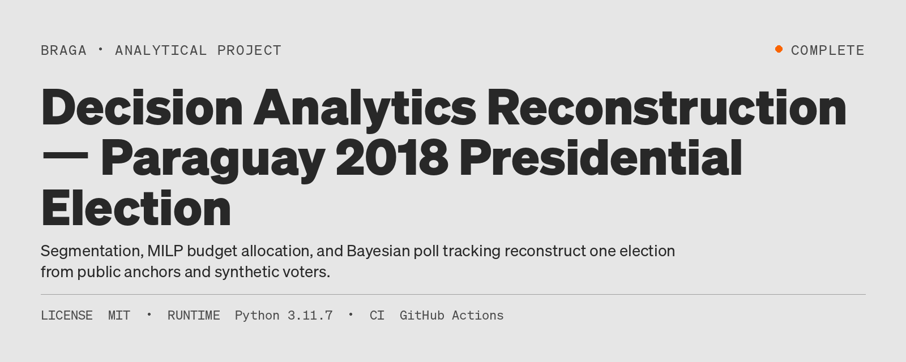
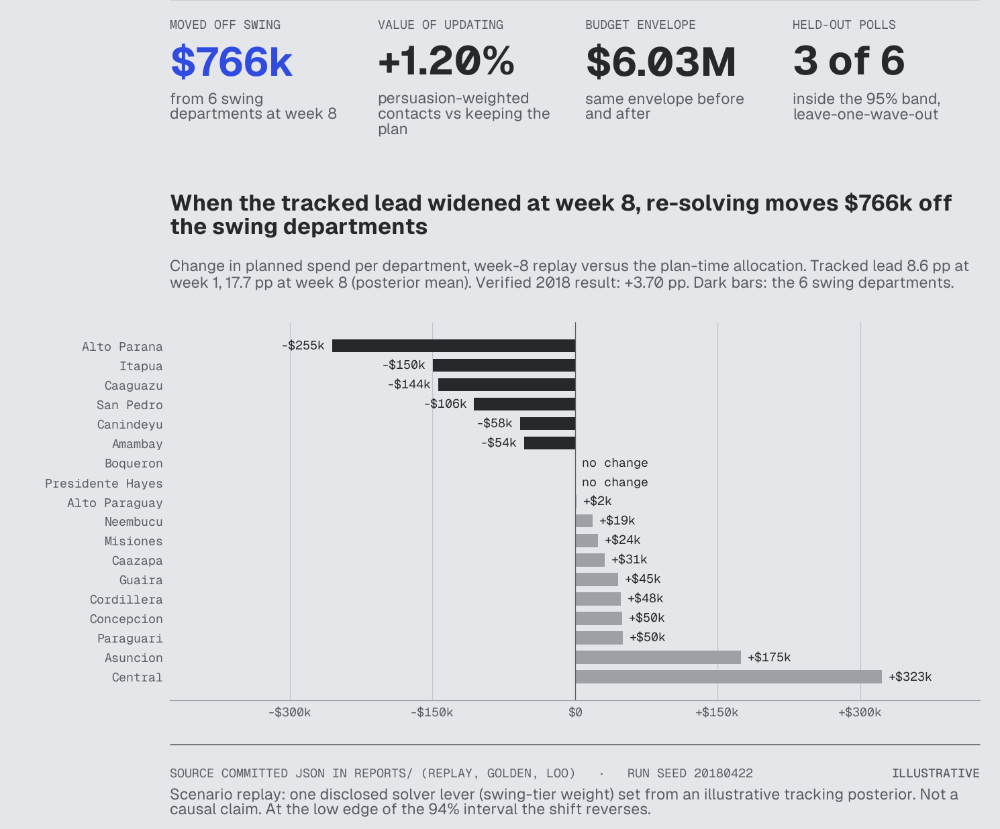
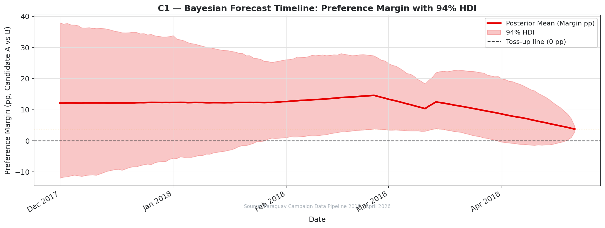
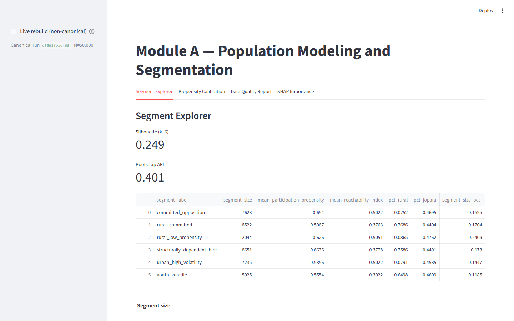
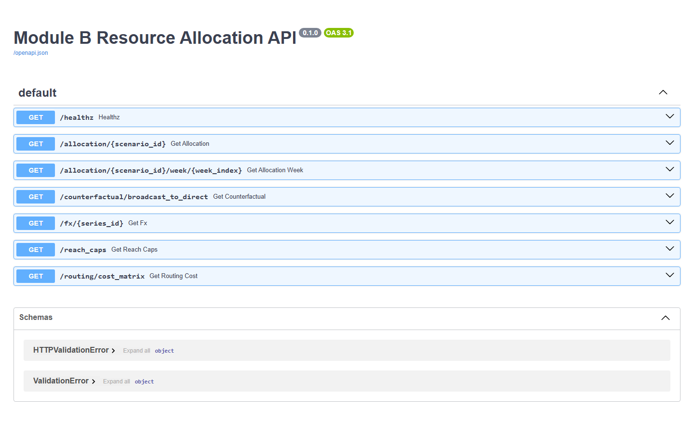
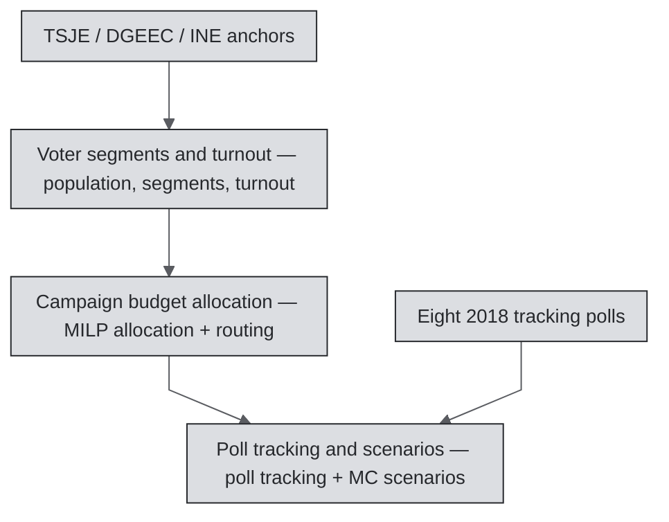

# Decision Analytics Reconstruction — Paraguay 2018 Presidential Election



[](https://github.com/RafaelBraga-Kribitz/decision-analytics-reconstruction/actions/workflows/ci.yml)
[](https://github.com/RafaelBraga-Kribitz/decision-analytics-reconstruction/actions/workflows/governance.yml)
[](.python-version)
[](LICENSE)
[](#status)

**Status:** Complete

> - **Who decides:** the campaign manager, with an analyst.
> - **What they choose:** how to split a fixed budget across 18 departments, and when to re-plan it.
> - **Answer:** at week 8 the tracked lead widened. Re-solving the plan moves **$766k** off six swing departments. That gives **+1.20%** more persuasion-weighted contacts than the old plan, on a **$6.03M** plan.
> - **Main caveat:** this is an illustrative replay on synthetic voters, not a causal claim. At the low edge of the 94% interval, the shift reverses.
> - **Chart:** the decision panel below. Detail: [case study, week-8 replay](reports/CASE_STUDY.md#a-worked-decision-week-8-replay).

A campaign in early 2018 could see only eight public polls, census aggregates, and a fixed budget. **How should it track the race, split the money across the country, and stay honest about what it knows?** This project reconstructs the 2018 Paraguay presidential election as three connected decision-analytics parts. It answers that question end to end. The verified result: Candidate A (Abdo) won by **+3.70 pp** (46.43% vs 42.73%) on **61.25%** turnout (TSJE, the electoral court). One pp is one percentage point.

<p align="center"></p>

*The decision this system supports: the tracked lead widened from 8.6 pp to 17.7 pp at
week 8. Re-solving the allocation on the same $6.03M envelope moves **$766k off the six swing
departments** into strongholds and opposition departments. This is worth +1.20% persuasion-weighted
contacts over keeping the plan. A persuasion-weighted contact is a reachable contact scaled by a weight
that reflects how contested the department is. The result is an ILLUSTRATIVE scenario replay with one disclosed solver lever,
not a causal claim. At the pessimistic edge of the 94% interval the shift reverses. Detail:
[case study, week-8 replay](reports/CASE_STUDY.md#a-worked-decision-week-8-replay). The script
`scripts/generate_decision_kpi_panel.py` generates the panel from committed results only.*

<p align="center"></p>

*Poll tracking and scenarios (Bayesian poll tracking). This is a **retrodiction, not a forecast**: the model is checked against the known result.
It uses the verified TSJE outcome and reconciles the eight real 2018 poll waves inside
a 94% credible band. Out-of-sample scoring is a separate, honest exercise. See Results.*

## Decision summary

The system runs three parts in one pipeline:

1. **Voter segments and turnout:** synthetic voter segmentation and turnout propensity.
2. **Campaign budget allocation:** a MILP (mixed-integer linear program, a solver that picks the best spend under fixed rules) plus field routing.
3. **Poll tracking and scenarios:** Bayesian poll tracking plus Monte Carlo scenarios.

Public anchors are **VERIFIED** (TSJE returns, DGEEC/INE census aggregates, eight
published 2018 polls). Every individual voter record is **SIMULATED**. Calibration to those
anchors is **CALIBRATED**. Tracking posteriors and Monte Carlo shocks are **ILLUSTRATIVE**. Full
register: [`reports/epistemic_boundaries.md`](reports/epistemic_boundaries.md).

The reconstruction does **not** claim that analytics caused the +3.70 pp margin. The public
result is the ground-truth anchor. The point of the work is to show what the model can show, and what it cannot.

## See it running

<p align="center">
  
</p>

*Voter segments and turnout dashboard (Streamlit). The Segment Explorer shows the canonical 50,000-voter run. The app shows the run ID and diagnostics.*

<p align="center">
  
</p>

*Campaign budget allocation API (FastAPI). These are the live OpenAPI docs. Every endpoint serves solver outputs from the canonical run.*

Hosted demos:
[voter segments dashboard](https://decision-analytics-module-a.onrender.com) (Render; the free tier sleeps, so the first load can take a minute),
[budget allocation API docs](https://decision-analytics-module-b-production.up.railway.app/docs) (Railway), and the
[poll tracking report](https://RafaelBraga-Kribitz.github.io/decision-analytics-reconstruction/) (GitHub Pages).
Both apps also run locally with `make dashboard` and `make module-b-api`. The screenshots above come from local runs of this repo.
A script checks every live link. See "Governance" in [Status](#status).

## Explore this project

| Audience | Start here |
|---|---|
| Recruiter | This page through [Results](#results) (2-minute summary) |
| Hiring manager | [Decision summary](#decision-summary) + [How it works](#how-it-works) + [Known limits](#known-limits) |
| Technical reviewer | [Architecture](ARCHITECTURE.md) + [Reproduce](#reproduce) + the three part folders |
| Auditor | [Data](#data) + [Validation](#validation) + [`governance/AUDIT_PROCEDURE.md`](governance/AUDIT_PROCEDURE.md) |

Case narrative: [`reports/CASE_STUDY.md`](reports/CASE_STUDY.md). Numeric SSOT (the single table of headline numbers):
[`reports/NUMERIC_SSOT.md`](reports/NUMERIC_SSOT.md). It wins over any narrative doc.

## Results

### Known real numbers (Series A)

| Quantity | Value |
|---|---|
| Outcome margin | **+3.70 pp** (46.43% vs 42.73%) |
| Turnout | **61.25%** |
| Production run scale | **50,000** voters (4.26M design reference) |
| Reconstruction window | **14 weeks** (2018-W01..W14); 18-week campaign scope, 14 ISO weeks of operational data |

### 3 of 6 held-out polls fell inside the 95% band

The test leaves one wave out at a time on the eight real 2018 polls. Each time, the tracking
model is refitted with the actual election result held out (provably excluded; see the forecast-label fix in the [Legend](#legend)).
The 95% uncertainty band caught the held-out poll in **3 of 6** tested waves (95% interval coverage
50%, exact binomial 95% CI [0.12, 0.88]; Brier 0.31 on the sign task; `MC_FAST=1` committed
artifact). This is the project's
*first true out-of-sample check*. The report does not flatter it. With only
**eight polls** the intervals are wide. The sample is far too small to claim forecasting
skill. Detail:
[`reports/module_c/walk_forward_loo_report.md`](reports/module_c/walk_forward_loo_report.md).

### Solver comparator (not a causal claim)

On the **$6M USD** reconstruction envelope, the budget-allocation MILP beats a department-uniform
naive allocation. It yields **~54.77%** more linearized persuasion-proxy contacts. This is a
solver comparator on synthetic reach. It is not a verified historical effect of the 2018 campaign.

## How it works

The chain is: question, public evidence, tagged assumptions, three models, uncertainty, and a constrained
allocation. It is not a causal counterfactual.

1. **Question.** Given only 2018-visible public signals and a fixed budget, how should a
   campaign track the race and spend, while it stays explicit about what is known?
2. **Evidence.** TSJE 2018 returns, DGEEC/INE census and ICT aggregates, and eight published
   tracking polls. Outlet, date, and figures are the checkable columns. Pollster labels are
   house-effect identifiers, not always the verbatim firm names.
3. **Assumptions.** Individual voters are synthetic. Department-level turnout, gender, rural
   share, and language buckets are raked to verified anchors. Budget allocation maximises a linearized
   persuasion-proxy under budget, reach-cap, FX, and an 80% coverage floor. The tracking
   posterior in poll tracking and scenarios is prior-dominated on poll-free days.
4. **Models.** Voter segments and turnout: K-Means (k=6) plus Platt-calibrated turnout propensity.
   Campaign budget allocation: PuLP/CBC MILP on 2,772 rows (18 departments × 11 channels × 14 weeks).
   Poll tracking and scenarios: a PyMC Gaussian random walk with house effects, then stratified Monte Carlo (10,000 draws
   default).
5. **Uncertainty.** The tracking path carries 94% credible bands. The eight-poll fixture gets
   walk-forward and leave-one-wave-out checks. The week-8 allocation replay in the case study reports HDI (highest density interval) endpoints.
6. **Decision rule.** Allocate the $6M envelope under the stated constraints. Do not treat
   the verified +3.70 pp margin as an analytics lift.

`make pipeline-full` runs the three parts in order, with an enforced allocation handoff.

## Data

| Source | What it anchors | Epistemic tag |
|---|---|---|
| TSJE 2018 final results | Margin **+3.70 pp**; national turnout **61.25%**; department roll counts | **VERIFIED** |
| DGEEC 2012 census / 2018 estimates | Rural share, language, age structure | **VERIFIED** (aggregates) |
| INE EPHC 2018 household survey | Urban/rural internet and WhatsApp penetration | **VERIFIED** (aggregates) |
| geoBoundaries PRY ADM1 (CC BY 4.0) | Department boundaries for the battleground map | **VERIFIED** (geometry) |
| Eight published 2018 tracking polls | Tracking likelihood; outlet/date/figures checkable | **VERIFIED** (those columns) |
| Synthetic 50,000-row voter file | Individual records; no real person is represented | **SIMULATED** / **CALIBRATED** at anchored aggregates |
| Campaign budget allocation and routing | Solver output on the $6M envelope | **SIMULATED** |
| Poll tracking daily posterior and Monte Carlo draws | Sparse-fixture tracking and shock scenarios | **ILLUSTRATIVE** |
| BCP exchange rate, retail FX spread, channel unit costs, department population | Budget allocation cost and reach inputs | **PRIOR, not yet verified** (hand-set placeholders) |

The Data Source Register lists every source with its origin, licence, date and verification status. It includes the four
PRIOR inputs above:
[Data Source Register](reports/epistemic_boundaries.md#data-source-register). Where an origin
URL or access date is not yet recorded, the register says so.

## Validation

This table shows how we know the numbers are not only plausible-looking:

| Skill / claim | Evidence in repo |
|---|---|
| Segmentation + turnout propensity | Voter segments and turnout pipeline; silhouette **> 0.22** (measured 0.2562 at 50k); bootstrap ARI **≥ 0.40** (measured 0.4304); Brier **< 0.237** (0.1185 at 15k holdout). AUC ≈0.89 is **circular** — not a generalization claim. |
| MILP under real constraints | Budget allocation OPTIMAL baseline, 80% coverage floor, ~54.77% linearized lift vs naive |
| Bayesian poll tracking + MC scenarios | PyMC models for poll tracking and scenarios, 0 NUTS divergences on the full v0.4 run, walk-forward scoring fix (see the [Legend](#legend)), leave-one-wave-out report |
| Pipeline integration | `dvc.yaml`, `make pipeline-full`, `tests/test_golden_metrics.py` |
| Statistical honesty | AUC circularity documented; no causal counterfactual fiction |
| Reproducibility | `make test`, `scripts/generate_golden_metrics.py`, fresh-clone path in CONTRIBUTING |

Validation gates: [`reports/VALIDATION.md`](reports/VALIDATION.md). Golden snapshot:
`reports/golden_metrics.json`.

## Architecture



| Part | Role | Entry |
|---|---|---|
| **Voter segments and turnout** | Voter dataset, segmentation, turnout propensity | `module_a_population_segmentation/` |
| **Campaign budget allocation** | Constrained allocation MILP + routing | `module_b_resource_allocation/` |
| **Poll tracking and scenarios** | Poll aggregation, Bayesian tracking, MC scenarios | `module_c_forecasting_scenarios/` |

Cross-part contracts live in `schema_contracts/`. Detail: [`ARCHITECTURE.md`](ARCHITECTURE.md).

### Stack

| Technology | Role |
|---|---|
| scikit-learn | Voter segments and turnout: K-Means segmentation and Platt-calibrated turnout propensity |
| pandera | Voter segments and turnout: schema validation of the synthetic voter file |
| PuLP / CBC | Campaign budget allocation: the budget-allocation MILP (mixed-integer linear program) |
| FastAPI | Campaign budget allocation: allocation and routing API |
| PyMC / ArviZ | Poll tracking and scenarios: Bayesian poll tracking and its convergence diagnostics |
| Streamlit | Voter segments and turnout dashboard |
| MLflow | Run manifest and tracking for the voter segments and turnout pipeline |
| DVC | Pipeline stages (`dvc.yaml`) |
| Poetry | Locked environment (`poetry.lock`) |
| matplotlib + bk-viz | Charts; the decision panel uses the portfolio chart theme (bk-viz), the EDA figures keep the repo's colour-blind-safe visual system |

## Reproduce

```bash
poetry install
make test

# Full integrated pipeline (A → B → C → EDA)
make pipeline-full

# Local demos
make dashboard       # Voter segments and turnout — Streamlit
make module-b-api    # Campaign budget allocation — FastAPI (http://127.0.0.1:8088/docs)
make module-c-all    # Poll tracking and scenarios — tracking + scenario artifacts
```

The run uses Python 3.11, a Poetry lockfile, and seed 42 on the canonical 50k run. Deployment notes:
[`docs/DEPLOYMENT.md`](docs/DEPLOYMENT.md). The live link check is `scripts/check_live_deployment_urls.py`.

## Known limits

- **No causal claim.** The verified +3.70 pp margin is a public election result, not an
  analytics treatment effect. A with/without-analytics counterfactual is unverifiable here.
- **Synthetic microdata.** No individual record is a real voter. Aggregate calibration does
  not imply the model recovered withheld personal behaviour.
- **Sparse polls.** The fixture holds eight tracking waves, and leave-one-wave-out n=6. Interval coverage is a
  structural diagnostic, not proof of calibration. The project does not claim forecasting skill.
- **Proxy objective.** Campaign budget allocation maximises linearized persuasion-adjusted contacts. It does not use
  audited 2018 campaign accounting or fitted media-mix response curves.
- **Scale.** The default run covers 50,000 voters over 14 ISO weeks. The 4.26M roll and full
  18-week operational campaign are design references. The pipeline does not execute them.
- **AUC is circular.** Propensity features share calibration anchors with the target.
  Do not headline AUC as generalization.
- **Falsification.** Real department-level labelled microdata, a larger independent poll
  panel, or empirically estimated response curves would change what can be claimed. They
  would also retire several SIMULATED / ILLUSTRATIVE tags.

## What I would do with production data

This reconstruction uses public aggregates plus synthetic microdata. A live campaign
file would change the work in these ways:

1. **Replace the voter file.** Swap the 50,000 synthetic rows for a privacy-governed
   electoral roll or CRM extract. Keep the same schema contracts, so budget allocation and poll tracking do not
   change shape.
2. **Replace the poll fixture.** Ingest live house-identified tracking with real sample
   sizes and field windows. Drop pseudonymized pollster labels. Re-run walk-forward on
   held-out waves that were not used to design the model.
3. **Replace the proxy objective.** Estimate channel response from observed contacts or
   spend. Then constrain the MILP with those curves instead of piecewise-linear policy
   caps.
4. **Break circularity in propensity.** Hold out departments or drop the logit offset, so
   Brier/AUC measure generalization rather than rake recovery.
5. **Close the loop from budget allocation to poll tracking.** Feed tracking posteriors back into the allocator automatically
   (the week-8 replay in the case study is a disclosed manual re-parameterization, not
   pipeline behaviour).
6. **Run at roll scale.** The 4.26M design reference and the unused weeks of the 18-week
   campaign become data problems, not narrative ones.

Until that swap-in exists, every individual-level chart remains a reconstruction, and
every decision number must carry its epistemic tag.

## Repository structure

| Path | Responsibility |
|---|---|
| `module_a_population_segmentation/` | Synthetic population, segments, turnout propensity, Streamlit dashboard |
| `module_b_resource_allocation/` | MILP allocator, routing, FastAPI |
| `module_c_forecasting_scenarios/` | Bayesian tracking, Monte Carlo, Quarto report |
| `schema_contracts/` | Versioned cross-part artifact contracts |
| `shared/` | Shared validators and visual system |
| `reports/` | NUMERIC_SSOT, epistemic register, validation, EDA charts |
| `governance/` | Findings, ADRs, audit procedure, session handoff |
| `docs/` | Deployment, agent protocol, screenshots |
| `scripts/` | Golden metrics, live-URL probe, SSOT and terminology gates |
| `tests/` | Cross-cutting contract and CI tests |

### Legend

Folders, files and findings keep their original codes. This table gives each one a plain name.

| Plain name | Code in files and reports |
|---|---|
| Voter segments and turnout | Module A, `module_a_population_segmentation/` |
| Campaign budget allocation | Module B, `module_b_resource_allocation/` |
| Poll tracking and scenarios | Module C, `module_c_forecasting_scenarios/` |
| Live link check (demo links must stay live) | finding `F-021` |
| Forecast-label fix (the "forecast" line was a retrodiction) | finding `F-069` |
| Walk-forward scoring fix (the right quantity is scored) | finding `F-034` |
| Poll-tracking figure | `C1_forecast_timeline.png` ("C1" in chart file names) |

## Status

**Status:** Complete

All three parts run locally, through `make pipeline-full`, and as hosted demos.
Every governance finding is closed (70 total, 0 open). Every spec in the
statistical improvement plan (`governance/improvement_plan/INDEX.md`) is done.
A `verification_script` backs each closure. The governance Adversary
re-runs it on every PR, alongside the full-NUTS MCMC diagnostics lane and the
technical-debt ratchet (at zero). This is a portfolio reconstruction, not a
production campaign system.

Status as of 2026-10-11.

### Governance

Governance sits behind the analytics and is load-bearing. Every headline number lives in one
SSOT table and is CI-gated. Every closed audit finding is re-verified on each PR. AI-assisted
changes pass the same finding-verification gates as human ones ([`docs/agents/`](docs/agents/)).
See [`governance/AUDIT_PROCEDURE.md`](governance/AUDIT_PROCEDURE.md).

```bash
make session-start   # → governance/SESSION_HANDOUT.md
```

The script `scripts/check_live_deployment_urls.py` (the live link check) verifies the demo links. This README never claims a live URL that the script has not verified.
Free-tier hosts sleep. A down demo means the live link check regressed and must be reopened.

## License

Code is released under the [MIT License](LICENSE). Calibration anchors derive
from public sources (TSJE, DGEEC, INE, BCP) and are not separately licensed by
this project. All microdata is synthetic.

## Author

<table>
  <tr>
    <td width="110">
      
    </td>
    <td>
      <strong>Rafael Braga-Kribitz</strong><br />
      Seiersberg-Pirka, Austria · Portfolio project, 2026<br />
      <a href="https://www.linkedin.com/in/rafaelbragakribitz/">LinkedIn</a>
      ·
      <a href="mailto:rafaelbragakribitz@gmail.com">rafaelbragakribitz@gmail.com</a>
    </td>
  </tr>
</table>
