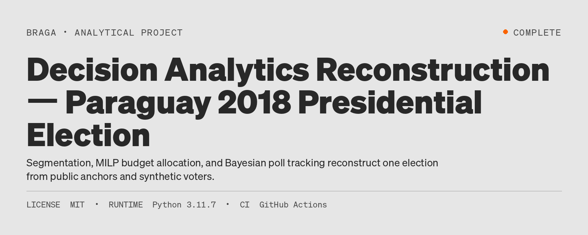
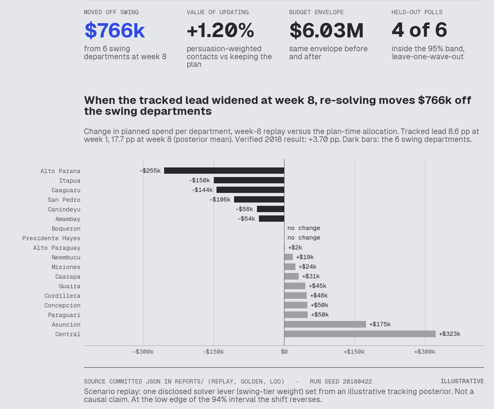
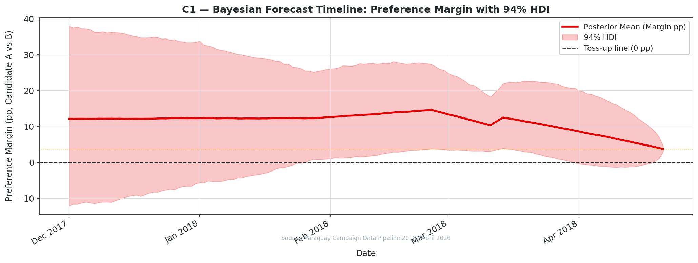
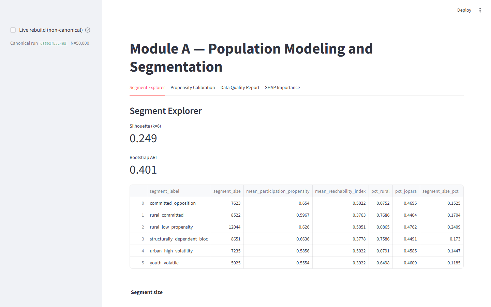
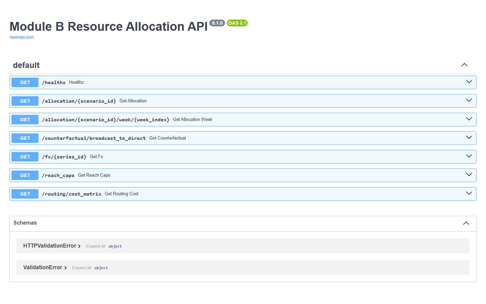
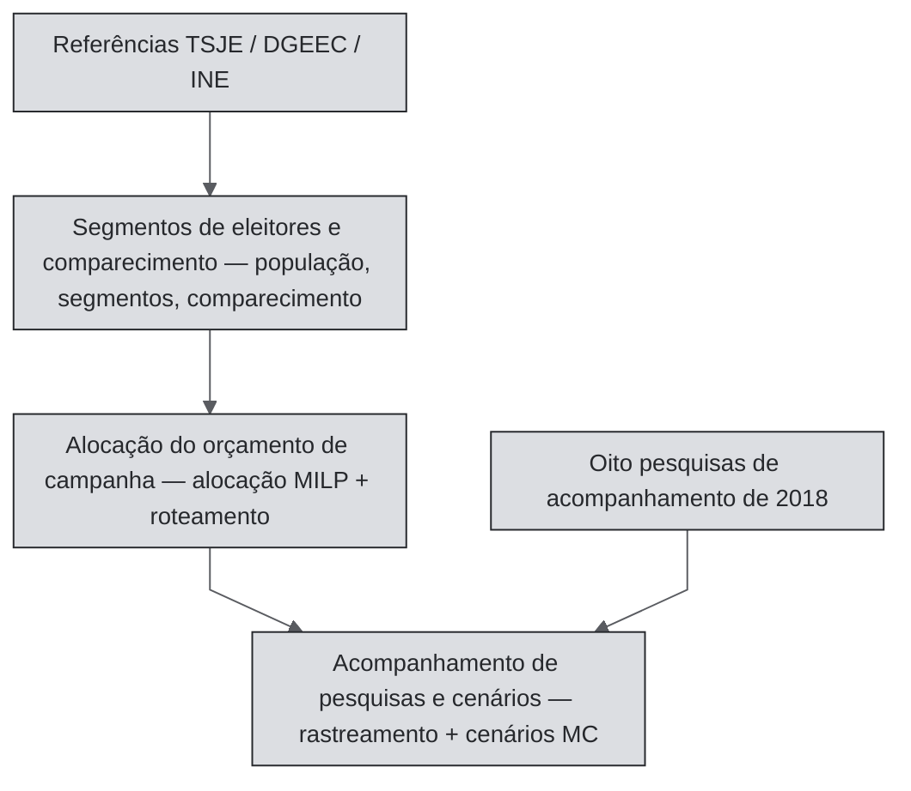

[🇧🇷 PT-BR](README.pt-BR.md) · [🇬🇧 EN-UK](README.md) · [🇦🇹 DE-AT](README.de-AT.md)

# Reconstrução de Decision Analytics — Eleição presidencial do Paraguai de 2018



[](https://github.com/RafaelBraga-Kribitz/decision-analytics-reconstruction/actions/workflows/ci.yml)
[](https://github.com/RafaelBraga-Kribitz/decision-analytics-reconstruction/actions/workflows/governance.yml)
[](.python-version)
[](LICENSE)
[](#status)

**Status:** Concluído

> - **Quem decide:** o gestor da campanha, com apoio de um analista.
> - **O que escolhe:** como dividir um orçamento fixo entre 18 departamentos e se deve refazer o plano quando a vantagem monitorada muda.
> - **Resposta:** na semana 8, a vantagem monitorada aumentou. Uma reprodução que resolve novamente o plano após uma atualização manual de pesos desloca **US$ 766 mil** para fora de seis departamentos competitivos. Isso representa **+1,20%** em contatos ponderados por persuasão em relação ao plano anterior, com um orçamento de **US$ 6,03 milhões**.
> - **Principal ressalva:** esta é uma reprodução ilustrativa com eleitores sintéticos, não uma alegação causal. No limite inferior do intervalo de 94%, a mudança se inverte.
> - **Gráfico:** o painel de decisão abaixo. Detalhes: [estudo de caso, reprodução da semana 8](reports/CASE_STUDY.md#a-worked-decision-week-8-replay).

No início de 2018, uma campanha teria acesso a apenas oito pesquisas públicas, agregados censitários e um orçamento fixo. **Como deveria acompanhar a disputa, distribuir o dinheiro pelo país e ser transparente sobre o que sabe?** Este projeto reconstrói a eleição presidencial paraguaia de 2018 como três componentes conectados de análise decisória. Ele responde à pergunta de ponta a ponta. Resultado verificado: o candidato A (Abdo) venceu por **+3,70 pp** (46,43% contra 42,73%), com comparecimento de **61,25%** (TSJE, a autoridade eleitoral). Um pp é um ponto percentual.

<p align="center"></p>

*Esta é a decisão que o sistema apoia: a vantagem monitorada aumentou de 8,6 pp para 17,7 pp na semana 8. Uma reprodução que resolve novamente a alocação após uma atualização manual dos pesos, mantendo o mesmo orçamento de US$ 6,03 milhões, desloca **US$ 766 mil dos seis departamentos competitivos** para redutos e departamentos de oposição. Isso representa +1,20% em contatos ponderados por persuasão em relação a manter o plano. Um contato ponderado por persuasão é um contato alcançável ajustado por um peso que reflete o grau de disputa do departamento. O resultado é uma reprodução de cenário **ILUSTRATIVA**, com uma alavanca do solver explicitada, e não uma alegação causal. No limite pessimista do intervalo de 94%, a mudança se inverte. Detalhes: [estudo de caso, reprodução da semana 8](reports/CASE_STUDY.md#a-worked-decision-week-8-replay). O script `scripts/generate_decision_kpi_panel.py` gera o painel apenas a partir dos resultados versionados no repositório.*

<p align="center"></p>

*Acompanhamento de pesquisas e cenários (rastreamento bayesiano de pesquisas). Isto é uma **retrodicção, não uma previsão**. O ajuste usa o resultado conhecido do TSJE como entrada. Portanto, a linha precisa terminar perto de +3,70 pp, e essa concordância não é um teste independente. O modelo também reconcilia as oito ondas reais de pesquisas de 2018 dentro de uma faixa de credibilidade de 94%. A pontuação sem o resultado conhecido é uma análise separada. Consulte Resultados.*

## Resumo da decisão

O sistema executa três partes em uma pipeline:

1. **Segmentos de eleitores e comparecimento:** segmentação sintética de eleitores e propensão ao comparecimento.
2. **Alocação do orçamento de campanha:** uma MILP (programação linear inteira mista, um solver que escolhe a melhor alocação sob regras fixas) e roteamento de campo.
3. **Acompanhamento de pesquisas e cenários:** rastreamento bayesiano de pesquisas e cenários de Monte Carlo.

As referências públicas são **VERIFICADAS** (resultados do TSJE, agregados censitários da DGEEC/INE e oito pesquisas publicadas de 2018). Cada registro individual de eleitor é **SIMULADO**. A calibração dessas referências é **CALIBRADA**. As distribuições posteriores do rastreamento e os choques de Monte Carlo são **ILUSTRATIVOS**. Consulte o [registro completo](reports/epistemic_boundaries.md).

Em resumo: o sistema lê pesquisas públicas e dados censitários e gera eleitores sintéticos. Ele resolve a melhor alocação para um orçamento fixo. Uma reprodução ilustrativa separada mostra a alocação resolvida novamente após uma atualização manual de pesos. A pipeline não faz isso automaticamente: a realimentação automática do rastreamento de pesquisas para a alocação orçamentária é trabalho futuro. O método detalhado está em [Como funciona](#como-funciona), depois de Limitações conhecidas.

A reconstrução **não** afirma que a análise causou a margem de +3,70 pp. O resultado público é a referência de verdade observada. O objetivo é mostrar o que o modelo pode revelar e o que não pode.

## Por que este projeto existe

Uma campanha distribui um orçamento fixo entre 18 departamentos e precisa decidir quando refazer o plano conforme as pesquisas mudam. Este projeto testa se segmentos de eleitores, otimização do orçamento e rastreamento bayesiano de pesquisas podem melhorar essa distribuição em relação a planilhas. A avaliação anterior à construção estimou um valor de 1,3% de um orçamento entre US$ 4 milhões e US$ 5,5 milhões, cerca de €62 mil, diante de um custo central de €17.280. Isso equivale a 3,6× e, portanto, fica pouco abaixo do requisito financeiro de 4×; uma construção limitada a cerca de 285 horas passa. Resultado observado: ainda não medido. Detalhes: [avaliação econômica](docs/economic-evaluation.md).

## Veja em execução

<p align="center">
  
</p>

*Dashboard de segmentos de eleitores e comparecimento (Streamlit). O Segment Explorer mostra a execução canônica com 50.000 eleitores. O aplicativo exibe o ID da execução e os diagnósticos.*

<p align="center">
  
</p>

*API de alocação do orçamento de campanha (FastAPI). Esta é a documentação OpenAPI em execução. Cada endpoint apresenta resultados do solver da execução canônica.*

Demonstrações hospedadas:
[dashboard de segmentos de eleitores](https://decision-analytics-module-a.onrender.com) (Render; o plano gratuito entra em suspensão, então a primeira abertura pode levar um minuto),
[documentação da API de alocação](https://decision-analytics-module-b-production.up.railway.app/docs) (Railway) e o
[relatório de acompanhamento de pesquisas](https://RafaelBraga-Kribitz.github.io/decision-analytics-reconstruction/) (GitHub Pages).
Os dois aplicativos também rodam localmente com `make dashboard` e `make module-b-api`. As capturas acima vêm de execuções locais deste repositório.
Um script verifica todos os links ativos. Consulte “Governança” em [Status](#status).

## Explore este projeto

| Público | Comece por |
|---|---|
| Recrutador | Esta página até [Resultados](#resultados) (resumo de 2 minutos) |
| Gestor de contratação | [Resumo da decisão](#resumo-da-decisão) + [Como funciona](#como-funciona) + [Limitações conhecidas](#limitações-conhecidas) |
| Revisor técnico | [Arquitetura](ARCHITECTURE.md) + [Reproduza](#reproduza) + as três pastas de componentes |
| Auditor | [Dados](#dados) + [Validação](#validação) + [procedimento de auditoria](governance/AUDIT_PROCEDURE.md) |

Narrativa do caso: [`reports/CASE_STUDY.md`](reports/CASE_STUDY.md). SSOT numérico (a tabela única com os números principais):
[`reports/NUMERIC_SSOT.md`](reports/NUMERIC_SSOT.md). Esse arquivo prevalece sobre qualquer documento narrativo.

## Resultados

### Números reais conhecidos (Série A)

| Métrica | Valor |
|---|---|
| Margem do resultado | **+3,70 pp** (46,43% contra 42,73%) |
| Comparecimento | **61,25%** |
| Escala da execução de produção | **50.000** eleitores (referência de projeto: 4,26 milhões) |
| Janela da reconstrução | **14 semanas** (2018-W01..W14); escopo de campanha de 18 semanas, 14 semanas ISO de dados operacionais |

### 3 de 6 pesquisas retidas ficaram dentro da faixa de 95%

O teste retira uma onda por vez das oito pesquisas reais de 2018. Em cada rodada, o modelo de acompanhamento é ajustado novamente sem o resultado eleitoral real (exclusão comprovada; consulte a correção dos rótulos de previsão na [Legenda](#legenda)).
A faixa de incerteza de 95% conteve a pesquisa retida em **3 de 6** ondas testadas (cobertura de intervalo de 50%, IC binomial exato de 95% [0,12; 0,88]; Brier 0,31 na tarefa de sinal; artefato versionado com `MC_FAST=1`). Esta é a *primeira verificação genuína fora da amostra* do projeto. O relatório não exagera o resultado. Com apenas **oito pesquisas**, os intervalos são amplos. A amostra é pequena demais para alegar capacidade preditiva. Detalhes:
[`reports/module_c/walk_forward_loo_report.md`](reports/module_c/walk_forward_loo_report.md).

### Comparação do solver (não é uma alegação causal)

No orçamento de reconstrução de **US$ 6 milhões**, a MILP de alocação orçamentária supera uma alocação ingênua uniforme por departamento. Ela produz **~54,77%** mais contatos proxy de persuasão linearizada. Esta comparação usa um solver e alcance sintético. Não é um efeito histórico verificado da campanha de 2018.

## Dados

| Fonte | O que ancora | Classificação epistêmica |
|---|---|---|
| Resultados finais de 2018 do TSJE | Margem **+3,70 pp**; comparecimento nacional **61,25%**; eleitorado por departamento | **VERIFICADO** |
| Censo DGEEC 2012 / estimativas de 2018 | Proporção rural, idioma, estrutura etária | **VERIFICADO** (agregados) |
| Pesquisa domiciliar INE EPHC 2018 | Penetração de internet e WhatsApp em áreas urbanas/rurais | **VERIFICADO** (agregados) |
| geoBoundaries PRY ADM1 (CC BY 4.0) | Limites departamentais para o mapa de disputa | **VERIFICADO** (geometria) |
| Oito pesquisas de acompanhamento publicadas em 2018 | Verossimilhança do rastreamento; veículo, data e números verificáveis | **VERIFICADO** (essas colunas) |
| Arquivo sintético com 50.000 eleitores | Registros individuais; nenhuma pessoa real é representada | **SIMULADO** / **CALIBRADO** nos agregados de referência |
| Alocação e roteamento do orçamento de campanha | Saída do solver no orçamento de US$ 6 milhões | **SIMULADO** |
| Distribuição posterior diária e amostras de Monte Carlo do rastreamento | Rastreamento com dados escassos e cenários de choque | **ILUSTRATIVO** |
| Câmbio do BCP, spread cambial de varejo, custos unitários de canais, população departamental | Custos e alcance da alocação orçamentária | **PRIOR, ainda não verificado** (valores provisórios definidos manualmente) |

O Registro de Fontes de Dados lista cada fonte, origem, licença, data e status de verificação. Ele inclui as quatro entradas **PRIOR** acima:
[Registro de Fontes de Dados](reports/epistemic_boundaries.md#data-source-register). Quando ainda não há URL de origem ou data de acesso, o registro informa isso.

## Validação

Esta tabela mostra como sabemos que os números não são apenas plausíveis à primeira vista:

| Competência / alegação | Evidência no repositório |
|---|---|
| Segmentação + propensão ao comparecimento | Pipeline de segmentos e comparecimento; silhouette **> 0,22** (0,2562 medido em 50 mil); ARI por bootstrap **≥ 0,40** (0,4304 medido); Brier **< 0,237** (0,1185 em holdout de 15 mil). AUC ≈0,89 é **circular** — não é uma alegação de generalização. |
| MILP com restrições reais | Linha de base da alocação orçamentária: OPTIMAL, cobertura mínima de 80%, ganho linearizado de ~54,77% em relação ao método ingênuo |
| Rastreamento bayesiano de pesquisas + cenários de Monte Carlo | Modelos PyMC para pesquisas e cenários, 0 divergências NUTS na execução completa v0.4, correção da pontuação walk-forward (consulte a [Legenda](#legenda)), relatório leave-one-wave-out |
| Integração da pipeline | `dvc.yaml`, `make pipeline-full`, `tests/test_golden_metrics.py` |
| Rigor estatístico | Circularidade da AUC documentada; sem contrafactual causal fictício |
| Reprodutibilidade | `make test`, `scripts/generate_golden_metrics.py`, instruções para clone limpo em CONTRIBUTING |

Critérios de validação: [`reports/VALIDATION.md`](reports/VALIDATION.md). Snapshot de referência:
`reports/golden_metrics.json`.

## Arquitetura



| Parte | Função | Pasta |
|---|---|---|
| **Segmentos de eleitores e comparecimento** | Base de eleitores, segmentação, propensão ao comparecimento | `module_a_population_segmentation/` |
| **Alocação do orçamento de campanha** | MILP de alocação com restrições + roteamento | `module_b_resource_allocation/` |
| **Acompanhamento de pesquisas e cenários** | Agregação de pesquisas, rastreamento bayesiano, cenários MC | `module_c_forecasting_scenarios/` |

Os contratos entre componentes ficam em `schema_contracts/`. Detalhes: [`ARCHITECTURE.md`](ARCHITECTURE.md).

### Stack

| Tecnologia | Função |
|---|---|
| scikit-learn | Segmentos de eleitores e comparecimento: segmentação K-Means e propensão calibrada por Platt |
| pandera | Segmentos de eleitores e comparecimento: validação do esquema do arquivo de eleitores sintéticos |
| PuLP / CBC | Alocação do orçamento: MILP de alocação (programação linear inteira mista) |
| FastAPI | Alocação do orçamento: API de alocação e roteamento |
| PyMC / ArviZ | Acompanhamento e cenários: rastreamento bayesiano e diagnósticos de convergência |
| Streamlit | Dashboard de segmentos de eleitores e comparecimento |
| MLflow | Manifesto e rastreamento das execuções da pipeline de segmentos |
| DVC | Etapas da pipeline (`dvc.yaml`) |
| Poetry | Ambiente bloqueado (`poetry.lock`) |
| matplotlib + bk-viz | Gráficos; o painel de decisão usa o tema visual do portfólio (bk-viz), enquanto os gráficos de EDA mantêm o sistema de cores acessível a pessoas com daltonismo do repositório |

## Reproduza

```bash
poetry install
make test

# Pipeline integrada completa (A → B → C → EDA)
make pipeline-full

# Demonstrações locais
make dashboard       # Segmentos de eleitores e comparecimento — Streamlit
make module-b-api    # API de alocação de campanha — FastAPI (http://127.0.0.1:8088/docs)
make module-c-all    # Rastreamento de pesquisas e cenários — artefatos de rastreamento e cenários
```

A execução usa Python 3.11, um arquivo de bloqueio do Poetry e seed 42 na execução canônica com 50 mil registros. Notas de implantação:
[`docs/DEPLOYMENT.md`](docs/DEPLOYMENT.md). A verificação de links ativos está em `scripts/check_live_deployment_urls.py`.

## Limitações conhecidas

- **Sem alegação causal.** A margem verificada de +3,70 pp é um resultado eleitoral público, não um efeito de tratamento analítico. Não é possível verificar aqui um contrafactual com e sem análise.
- **Microdados sintéticos.** Nenhum registro individual corresponde a um eleitor real. Calibrar agregados não significa que o modelo recuperou comportamentos pessoais não observados.
- **Poucas pesquisas.** A base contém oito ondas de acompanhamento; no leave-one-wave-out, n=6. A cobertura dos intervalos é um diagnóstico estrutural, não uma prova de calibração. O projeto não alega capacidade preditiva.
- **Objetivo proxy.** A alocação maximiza contatos ajustados por persuasão linearizada. Não usa a contabilidade auditada da campanha de 2018 nem curvas de resposta de mídia ajustadas aos dados.
- **Escala.** A execução padrão cobre 50.000 eleitores em 14 semanas ISO. O eleitorado de 4,26 milhões e a campanha operacional de 18 semanas são referências de projeto. A pipeline não os executa.
- **AUC circular.** As variáveis de propensão compartilham referências de calibração com o alvo. Não apresente a AUC como evidência de generalização.
- **Falsificação.** Microdados rotulados reais por departamento, um painel independente maior de pesquisas ou curvas de resposta estimadas empiricamente mudariam o que se pode afirmar. Também eliminariam algumas classificações SIMULADO / ILUSTRATIVO.

## O que eu faria com dados de produção

Esta reconstrução usa agregados públicos e microdados sintéticos. Um arquivo de campanha real mudaria o trabalho da seguinte forma:

1. **Substituir o arquivo de eleitores.** Trocar as 50.000 linhas sintéticas por um cadastro eleitoral ou extrato de CRM com governança de privacidade. Manter os mesmos contratos de esquema para que a alocação orçamentária e o rastreamento de pesquisas conservem o mesmo formato.
2. **Substituir a base de pesquisas.** Ingerir pesquisas de acompanhamento atuais, identificadas por instituto, com tamanhos de amostra e períodos de coleta reais. Remover rótulos de institutos pseudonimizados. Reexecutar o walk-forward em ondas retidas que não tenham sido usadas para desenhar o modelo.
3. **Substituir o objetivo proxy.** Estimar a resposta dos canais com base em contatos ou gastos observados. Em seguida, restringir a MILP com essas curvas, em vez de limites de política linearizados por partes.
4. **Eliminar a circularidade da propensão.** Reter departamentos ou remover o offset logit para que Brier/AUC meçam generalização, e não a recuperação do ajuste por raking.
5. **Conectar o rastreamento à alocação.** Passar automaticamente as distribuições posteriores do rastreamento para o alocador (a reprodução da semana 8 no estudo de caso é uma reparametrização manual declarada, não o comportamento da pipeline).
6. **Executar na escala do cadastro.** A referência de projeto de 4,26 milhões e as semanas não utilizadas da campanha de 18 semanas passam a ser problemas de dados, não de narrativa.

Até que essa substituição exista, todo gráfico em nível individual continua sendo uma reconstrução, e cada número de decisão deve manter sua classificação epistêmica.

## Como funciona

A sequência é: pergunta, evidência pública, hipóteses classificadas, três modelos, incerteza e uma alocação com restrições. Não é um contrafactual causal.

1. **Pergunta.** Com apenas sinais públicos disponíveis em 2018 e um orçamento fixo, como uma campanha deve acompanhar a disputa e gastar, mantendo clareza sobre o que é conhecido?
2. **Evidências.** Resultados do TSJE de 2018, agregados censitários e de TIC da DGEEC/INE e oito pesquisas de acompanhamento publicadas. Veículo, data e números são as colunas verificáveis. Os rótulos dos institutos identificam efeitos próprios de cada casa e nem sempre são os nomes literais das empresas.
3. **Hipóteses.** Os eleitores individuais são sintéticos. Comparecimento, gênero, proporção rural e categorias de idioma por departamento são ajustados aos agregados verificados por raking. A alocação maximiza um proxy linearizado de persuasão sob restrições de orçamento, limite de alcance, câmbio e cobertura mínima de 80%. Em dias sem pesquisas, a distribuição posterior do rastreamento é dominada pela priori.
4. **Modelos.** Segmentos de eleitores e comparecimento: K-Means (k=6) e propensão calibrada por Platt. Alocação do orçamento: MILP PuLP/CBC em 2.772 linhas (18 departamentos × 11 canais × 14 semanas). Acompanhamento de pesquisas e cenários: passeio aleatório gaussiano em PyMC com efeitos por instituto e, em seguida, Monte Carlo estratificado (10.000 amostras por padrão).
5. **Incerteza.** A trajetória de rastreamento traz faixas de credibilidade de 94%. A base de oito pesquisas passa por verificações walk-forward e leave-one-wave-out. A reprodução da alocação na semana 8 relata os limites do HDI (intervalo de maior densidade).
6. **Regra de decisão.** Alocar o orçamento de US$ 6 milhões sob as restrições declaradas. Não interpretar a margem verificada de +3,70 pp como ganho causado pela análise.

`make pipeline-full` executa as três partes em sequência, com transferência de alocação obrigatória.

## Estrutura do repositório

| Caminho | Responsabilidade |
|---|---|
| `module_a_population_segmentation/` | População sintética, segmentos, propensão ao comparecimento, dashboard Streamlit |
| `module_b_resource_allocation/` | Alocador MILP, roteamento, FastAPI |
| `module_c_forecasting_scenarios/` | Rastreamento bayesiano, Monte Carlo, relatório Quarto |
| `schema_contracts/` | Contratos versionados de artefatos entre partes |
| `shared/` | Validadores compartilhados e sistema visual |
| `reports/` | NUMERIC_SSOT, registro epistêmico, validação, gráficos EDA |
| `governance/` | Achados, ADRs, procedimento de auditoria, passagem de contexto da sessão |
| `docs/` | Implantação, protocolo de agentes, capturas de tela |
| `scripts/` | Métricas de referência, teste de URLs, verificações de SSOT e terminologia |
| `tests/` | Testes de contratos transversais e CI |

### Legenda

Pastas, arquivos e achados mantêm seus códigos originais. Esta tabela fornece nomes descritivos.

| Nome descritivo | Código nos arquivos e relatórios |
|---|---|
| Segmentos de eleitores e comparecimento | Módulo A, `module_a_population_segmentation/` |
| Alocação do orçamento de campanha | Módulo B, `module_b_resource_allocation/` |
| Acompanhamento de pesquisas e cenários | Módulo C, `module_c_forecasting_scenarios/` |
| Verificação de links ativos (links das demos devem continuar funcionando) | achado `F-021` |
| Correção do rótulo de previsão (a linha “forecast” era uma retrodicção: foi ajustada usando o resultado conhecido como entrada) | achado `F-069` |
| Correção da pontuação walk-forward (a variável correta é pontuada) | achado `F-034` |
| Gráfico de rastreamento das pesquisas | `C1_forecast_timeline.png` (“C1” nos nomes de arquivos dos gráficos) |

## Status

**Status:** Concluído

As três partes rodam localmente com `make pipeline-full` e nas demonstrações hospedadas.
Todos os achados de governança foram encerrados (70 no total, 0 em aberto). Todas as especificações do plano de melhoria estatística (`governance/improvement_plan/INDEX.md`) foram concluídas.
Um `verification_script` dá suporte a cada encerramento. O Adversary de governança executa novamente as verificações em cada PR, junto com a etapa de diagnóstico MCMC full-NUTS e o controle de dívida técnica (em zero). Esta é uma reconstrução de portfólio, não um sistema de campanha em produção.

Status em 2026-10-11.

### Governança

A governança sustenta a análise e é parte essencial do sistema. Cada número principal vive em uma tabela SSOT e passa por verificações de CI. Cada achado de auditoria encerrado é verificado novamente em cada PR. Alterações assistidas por IA passam pelos mesmos controles de verificação que alterações humanas ([`docs/agents/`](docs/agents/)).
Consulte [`governance/AUDIT_PROCEDURE.md`](governance/AUDIT_PROCEDURE.md).

```bash
make session-start   # → governance/SESSION_HANDOUT.md
```

O script `scripts/check_live_deployment_urls.py` (verificação de links ativos) valida os links das demonstrações. Este README não afirma que uma URL está ativa sem que o script a tenha verificado.
Hospedagens gratuitas entram em suspensão. Se uma demonstração estiver indisponível, a verificação de links regrediu e o achado deve ser reaberto.

## Licença

O código é distribuído sob a [Licença MIT](LICENSE). As referências de calibração derivam de fontes públicas (TSJE, DGEEC, INE, BCP) e não são licenciadas separadamente por este projeto. Todos os microdados são sintéticos.

## Autor

<table>
  <tr>
    <td width="110">
      
    </td>
    <td>
      <strong>Rafael Braga-Kribitz</strong><br />
      Seiersberg-Pirka, Áustria · Projeto de portfólio, 2026<br />
      <a href="https://www.linkedin.com/in/rafaelbragakribitz/">LinkedIn</a>
      ·
      <a href="mailto:rafaelbragakribitz@gmail.com">rafaelbragakribitz@gmail.com</a>
    </td>
  </tr>
</table>
